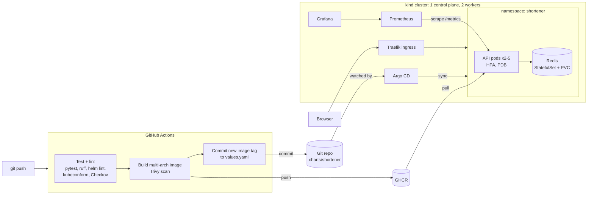

# k8s-gitops-shortener

A URL shortener API running on Kubernetes, deployed with **GitOps** (Argo CD) and monitored with **Prometheus and Grafana**. Pushing to `main` tests, scans and builds the image, then commits the new version to Git, and Argo CD rolls it out. Nobody runs `kubectl apply` by hand.

Runs on a local 3-node [kind](https://kind.sigs.k8s.io/) cluster, so it costs nothing to run.

## Architecture



## What's in it

| Area | How |
| --- | --- |
| App | Python FastAPI, Redis for storage, `/healthz`, `/readyz` and Prometheus `/metrics` |
| Container | Multi-stage build, non-root user, read-only filesystem, built for amd64 and arm64 |
| Kubernetes | Helm chart: Deployment, Service, Ingress, HPA (2 to 5 pods), PodDisruptionBudget, Redis StatefulSet with a persistent volume, NetworkPolicies |
| GitOps | Argo CD with auto-sync, self-heal and prune. CI commits the image tag, Argo CD deploys it |
| CI | GitHub Actions: ruff, pytest, helm lint, kubeconform, Checkov, Trivy (blocks on CRITICAL) |
| Observability | kube-prometheus-stack, a ServiceMonitor for the app, and a Grafana dashboard as code |
| Security | Restricted pod security settings, no service account tokens, Redis only reachable from the API, no registry secrets (uses the built-in `GITHUB_TOKEN`) |

## Design decisions

- **GitOps over push-based deploys.** CI never has cluster credentials. It only writes to Git, and the cluster pulls its desired state. Rolling back means reverting a commit.
- **Liveness and readiness are separate.** `/healthz` never checks Redis, so a Redis outage takes pods out of the load balancer (readiness) without restarting them in a loop (liveness).
- **No CPU limits, memory limits only.** CPU limits cause throttling even when the node has spare capacity. Memory limits stay, because memory can't be throttled. See `.checkov.yaml` for every deliberately skipped check.
- **Immutable SHA tags, not `latest`.** Every running pod maps to exactly one commit.
- **Low-cardinality metrics.** Requests are labelled by route template (`/{code}`), not the raw path, so each short code doesn't create a new metric series.

## Run it

### Prerequisites

Docker Desktop (running), plus `kind`, `kubectl` and `helm`. On an Apple Silicon Mac without Homebrew:

```bash
mkdir -p ~/bin && cd ~/bin
curl -Lo kind https://kind.sigs.k8s.io/dl/v0.26.0/kind-darwin-arm64
curl -LO https://dl.k8s.io/release/v1.32.0/bin/darwin/arm64/kubectl
curl -L https://get.helm.sh/helm-v3.16.4-darwin-arm64.tar.gz | tar xz --strip-components=1 darwin-arm64/helm
chmod +x kind kubectl helm
echo 'export PATH="$HOME/bin:$PATH"' >> ~/.zshrc && source ~/.zshrc
```

Give Docker Desktop at least **6 GB of memory** (Settings > Resources).

### Start

```bash
make up         # cluster + Traefik + metrics-server + Prometheus/Grafana + Argo CD + app (~10 min)
make status     # Argo CD sync state, pods, autoscaler
make passwords  # Argo CD and Grafana admin passwords
```

| URL | What |
| --- | --- |
| http://shortener.localtest.me/healthz | The app |
| http://argocd.localtest.me | Argo CD (user `admin`) |
| http://grafana.localtest.me | Grafana (user `admin`), dashboard "Shortener" |

`localtest.me` always resolves to `127.0.0.1`, so no `/etc/hosts` editing is needed.

### Try it

```bash
curl -X POST http://shortener.localtest.me/api/links \
  -H 'Content-Type: application/json' -d '{"url":"https://example.com"}'
# {"code":"aB3dE9x","url":"https://example.com/"}

curl -i http://shortener.localtest.me/aB3dE9x   # 307 redirect

make load-test   # then watch: kubectl get hpa -n shortener -w
```

### Things to try

- **Self-heal:** `kubectl scale deploy shortener-api -n shortener --replicas=0`, and Argo CD puts it back.
- **Roll back:** `git revert` the last `deploy:` commit and push. Argo CD rolls back to the previous image.
- **Readiness:** `kubectl delete pod shortener-redis-0 -n shortener`. API pods go not-ready while Redis restarts, but aren't restarted themselves.

### Stop

```bash
make down   # deletes the whole cluster
```

## Local development

```bash
cd app
python3 -m venv .venv && source .venv/bin/activate
pip install -r requirements-dev.txt
pytest -q && ruff check .
```

## Future improvements

- Pin images by digest instead of tag
- HTTPS with cert-manager
- Sealed Secrets or External Secrets for credentials
- Run the same chart on EKS with Terraform
